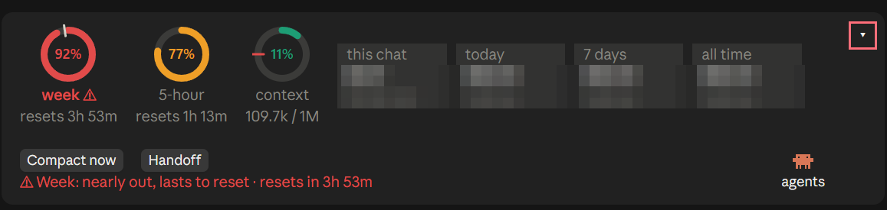

# Claude Mod Pack

[](https://ko-fi.com/finalpantasy)

**Small Claude Code mods that make the prompt area more useful: a status band for your usage limits, a switchboard for your mods, a button that hides them all, and OpenAI Codex as native subagents.**

Each mod installs on its own. Pick the ones you want.



*A real screenshot from the Claude desktop app. The dollar and token figures are pixelated.*

## Install

```
/plugin marketplace add finalpantasy/claude-mod-pack
/plugin install status-band@claude-mod-pack
/plugin install claude-mod-hider@claude-mod-pack
/plugin install codex-bridge@claude-mod-pack
```

Restart Claude Code after installing. Mods need Claude Code with mod support (function hooks).

## The mods

### Claude Status Band (`status-band`)

One tidy band above the prompt, each row labelled:

- **Week** and **5-hour**: your plan's limits as rings, with a pace for the week that learns when you actually work. Nights and weekends you are away are not counted as burn, and it gets more accurate the longer you use it.
- **Context**: how full the chat is and when it will need compacting (red from 75%).
- **Spend** and **Tokens**: this chat, today, 7 days and all time, across every open chat.
- **Last turn**: how long it took, files edited with lines added and removed, commands run, failures, reads and agents.
- **Tasks**: your open to-do list, from TodoWrite or claude-mem's work state.
- **Compact now** and **Handoff** buttons, always there. Handoff has Claude write a handoff packet and move the work to a fresh chat.

`/mods` opens a panel listing every installed mod with its full description and an on/off switch, plus a switch for each band row. `/band` hides or shows the band.

### Claude Mod Hider (`claude-mod-hider`)

One small arrow in the corner of the band. Click it and every mod above the prompt folds down to a single **▸ mods** button; click again and they are back. It remembers your choice across sessions. [More, including how other mods can opt in](claude-mod-hider/README.md).

### Claude Codex Bridge (`codex-bridge`)

Runs OpenAI Codex models as real Claude Code subagents. Each model becomes an agent type (`codex-bridge:sol`, `codex-bridge:sol-ro` for read-only, and so on) that the Agent tool can start like any other. You get the same task row, timer, token count, tool rows, background notice and SendMessage follow-ups as a native agent, which is handy for a second opinion from a different model family.

- Needs the [Codex CLI](https://github.com/openai/codex) installed and signed in.
- Set which models you get in the plugin's settings (`models`, as `name=model` pairs).

## Support

These are free hobby projects. If one saves you time, you can [buy me a coffee on Ko-fi](https://ko-fi.com/finalpantasy).

## License

MIT
